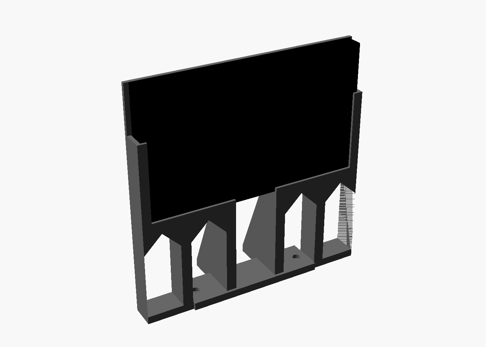
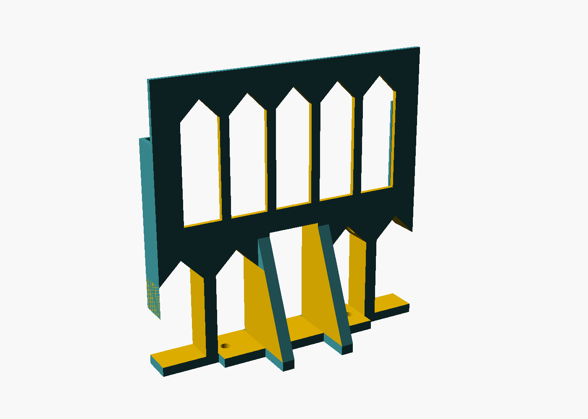
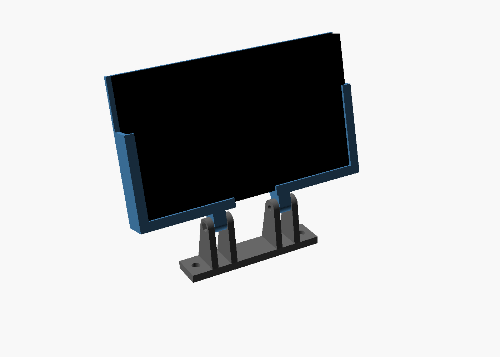
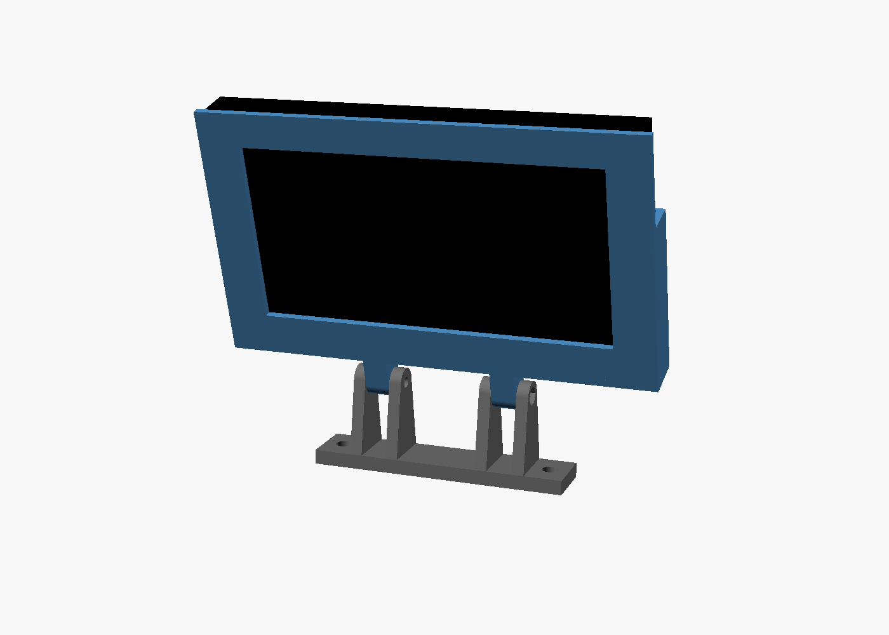

# Switch mount for the Moza R3

A 3D-printable holder that puts an original (V1) Nintendo Switch, without
Joy-Cons, on top of the Moza R3 wheel base where Moza-style dash and phone
mounts go. There are two versions.

## Flush (recommended)

One piece. The Switch stands straight up off the base (the R3 is already tilted) on a
60 mm riser with two braces at the back, so the whole screen sits above the wheel rim. Set `flush_raise` to 0 for
the low version you read through the wheel.




| File | Print | Notes |
| --- | --- | --- |
| `stl/flush.stl` | Standing up, plate on the bed, no supports | The vent slots have pointed tops so they print without support |

## Raised and tilting

Two parts on a hinge, 30 mm higher, for when the wheel hub hides a flush screen.




| File | Print | Notes |
| --- | --- | --- |
| `stl/foot.stl` | Flat on the plate, no supports | Bolts to the R3 |
| `stl/cradle.stl` | Flat on its back | Supports under the 4 mm lips are optional; most printers bridge them fine |

PETG or PLA, 4 walls, 20-30% infill. The cradle is about 179 x 127 mm, so it fits a 220 mm bed.

## Hardware

- 2x M3 socket head screws into the top of the R3 (try M3x10; use a shorter one if it bottoms out)
- Raised version only: 2x M4x25 bolts and 2x M4 nuts for the hinges (nyloc holds the tilt best). The nuts drop into the hex traps on the outer cheeks.

## Fit

- The Switch slides in from the top. The top edge stays open, so the vents, power and volume buttons, game card slot and headphone jack are all clear.
- The bottom ledge has a 34 mm gap for a USB-C cable to charge while racing. On the flush version, the Switch sits 12 mm up (`cable_clear`) so a right-angle USB-C plug fits underneath; set it to 0 to sit lower if you don't charge in it.
- The back has a large window over the rear air intake.

## Check before printing

These numbers are from research, not from a real R3. Measure with calipers and
change them at the top of `switch_moza_r3_mount.scad`:

- `r3_hole_spacing` (90 mm): centre-to-centre of the two M3 holes on top of the R3.
- `flush_raise` (60 mm): riser height. Raise it if the rim still cuts off the bottom of the screen, lower it if the Switch sits too high.
- `flush_tilt` (0 degrees): lean the flush version back if you want it angled more.
- `hinge_h` (30 mm): how high the hinge sits above the base. Raise it if the Switch is hidden behind the wheel.
- `sw_w`, `sw_h`, `sw_t` (173 x 101.9 x 13.9 mm): Switch V1 size. `fit` adds clearance.

## Rebuilding the STLs

```sh
openscad -D 'part="flush"'  -o stl/flush.stl  switch_moza_r3_mount.scad
openscad -D 'part="foot"'   -o stl/foot.stl   switch_moza_r3_mount.scad
openscad -D 'part="cradle"' -o stl/cradle.stl switch_moza_r3_mount.scad
```

Pushing a change to `mount/` rebuilds the STLs in GitHub Actions and publishes them as a release.
